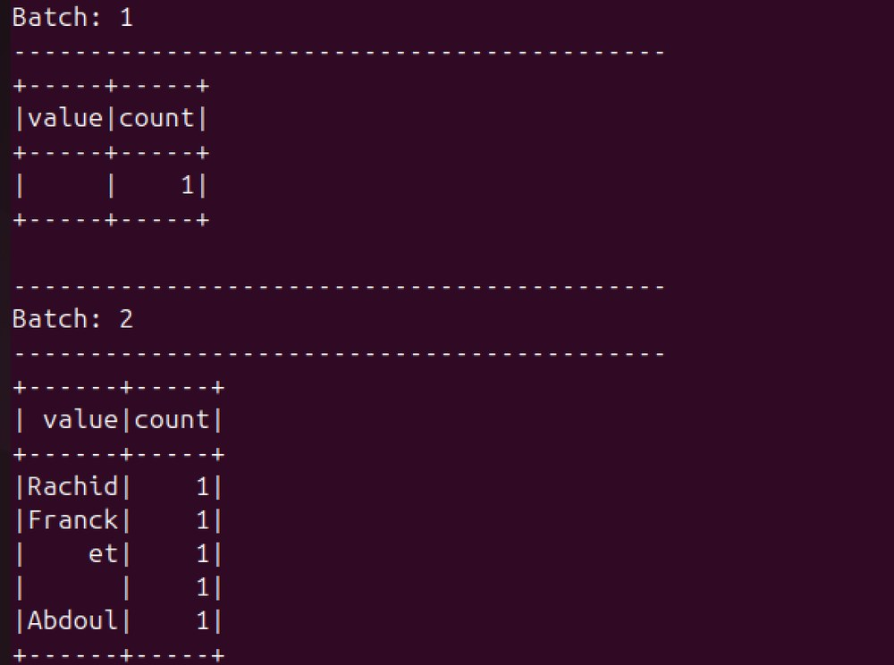

# Traitement batch et streaming avec Apache Spark sur Hadoop YARN

TP2 du module **Big Data** (INGC2, ESMT Dakar, 2025 à 2026, enseignant : Dr Mohamed Kaba KEITA). Le but : prendre en main Apache Spark sur un cluster Hadoop YARN de trois conteneurs Docker, d'abord en **traitement par lot (batch)**, puis en **streaming**.

> **TP guidé.** L'énoncé et le code de départ viennent du [TP2 « Traitement par Lot et Streaming avec Spark »](https://insatunisia.github.io/TP-BigData/tp2/) de Lilia Sfaxi (INSAT Tunisie, TP Big Data). Ce dépôt documente l'exécution du TP sur l'environnement de l'ESMT : le rapport décrit les étapes réalisées, les résultats obtenus et les captures.

## Ce que contient le TP

| Partie | Technologie | Ce qui est réalisé |
| --- | --- | --- |
| Batch interactif | Spark-Shell (Scala) | WordCount manipulé avec les RDD : transformations `flatMap`, `map`, `reduceByKey`, puis actions |
| Batch applicatif | Java 8, Maven, Spark Core | Classe `WordCountTask`, packagée en JAR et soumise avec `spark-submit` |
| Déploiement | Hadoop YARN | Exécution en mode local, puis en mode YARN client et YARN cluster |
| Streaming | Structured Streaming (Java) | Classe `Stream` : comptage de mots en continu à partir d'un flux réseau (netcat) |

## Environnement

| Composant | Version |
| --- | --- |
| Apache Spark | 3.5.0 (Scala 2.13) |
| Apache Hadoop | 3.3.6 |
| Java | 1.8 |
| Cluster | 3 conteneurs Docker : `hadoop-master` (NameNode et ResourceManager), `hadoop-worker1`, `hadoop-worker2` |
| Système hôte | Ubuntu 24.04 LTS, Visual Studio Code |

## Le code (fourni par l'énoncé du TP)

Les deux classes ci-dessous sont celles de l'énoncé, compilées et exécutées pendant le TP.

**Batch (`batch/`).** `WordCountTask` lit un fichier, le découpe avec `flatMap`, associe chaque terme à la valeur 1 avec `mapToPair`, additionne avec `reduceByKey`, puis écrit le résultat avec `saveAsTextFile`. Elle prend deux arguments : le chemin du fichier d'entrée et le dossier de sortie. Le découpage se fait sur la **tabulation**, comme pour le fichier de données du cours.

**Streaming (`streaming/`).** `Stream` lit un flux de lignes sur `localhost:9999`, les découpe en mots, puis calcule un comptage cumulé avec `groupBy("value").count()`. Le résultat est affiché dans la console toutes les secondes (`outputMode("complete")`, `Trigger.ProcessingTime("1 second")`).



## Choix techniques et justifications

**`reduceByKey` plutôt que `groupByKey`.** `reduceByKey` additionne d'abord les valeurs localement sur chaque partition, puis échange seulement les sommes partielles entre nœuds. Avec `groupByKey`, tous les couples transitent par le réseau avant d'être sommés, ce qui coûte beaucoup plus cher en shuffle.

**Mode YARN cluster plutôt que client.** En mode cluster, le driver tourne dans le cluster (dans l'Application Master), donc le job continue même si la machine qui l'a lancé s'éteint. Le mode client convient aux sessions interactives, car on voit directement la sortie du driver.

**Structured Streaming plutôt que l'ancienne API DStream.** L'API DataFrame est plus courte à écrire et bénéficie de l'optimiseur de Spark SQL.

**`outputMode("complete")`.** Le comptage de mots est une agrégation sur tout le flux : pour afficher des totaux cumulés, il faut réémettre la table complète à chaque micro-batch.

**Déclencheur d'une seconde.** Par défaut, Spark traite les données dès qu'elles arrivent (`ProcessingTime(0)`). Fixer une seconde rend la sortie lisible et reproductible pendant la démonstration.

## Reproduire

```bash
# Compilation de chaque projet (Maven, Java 8)
cd batch && mvn package
cd ../streaming && mvn package

# Batch en local
spark-submit --class spark.batch.tp21.WordCountTask --master "local[*]" \
  batch/target/wordcount-spark-1.0-SNAPSHOT.jar <fichier_entree> <dossier_sortie>

# Batch sur YARN (mode cluster ; remplacer par "client" pour le mode client)
spark-submit --class spark.batch.tp21.WordCountTask --master yarn --deploy-mode cluster \
  wordcount-spark-1.0-SNAPSHOT.jar <chemin_hdfs_entree> <dossier_hdfs_sortie>

# Streaming : terminal 1 (source des données), terminal 2 (job Spark)
nc -lk 9999
spark-submit --class spark.streaming.tp22.Stream streaming/target/stream-1.0-SNAPSHOT.jar
```

Les conteneurs Docker du cluster sont ceux fournis par le cours (les mêmes que pour le TP1 Hadoop, avec Spark préinstallé). Les captures des étapes de déploiement figurent dans le rapport.

## Limites

- `Stream.java` fixe `master("local[*]")` : le job s'exécute donc en local sur le nœud où il est lancé. Pour le soumettre à YARN, il faut retirer cette ligne et passer `--master yarn` à `spark-submit`.
- La source `socket` sert uniquement aux tests : elle n'offre aucune garantie de reprise après panne. Un usage réel passerait par Kafka ou des fichiers.
- Le comptage de mots reste un exercice pédagogique. Il illustre le modèle de traitement, pas une charge de production.

## Contenu du dépôt

```
spark-batch-streaming-yarn-docker/
├── README.md
├── batch/                 Projet Maven : WordCount (Java, Spark Core)
│   ├── pom.xml
│   └── src/main/{java,resources}
├── streaming/             Projet Maven : Structured Streaming (Java)
│   ├── pom.xml
│   └── src/main/java
└── docs/
    ├── Rapport_TP2_Spark_Batch_Streaming_YARN.pdf   Rapport complet (18 pages)
    └── images/
```

## Origine et attributions

- Énoncé et code de départ : Lilia Sfaxi, INSAT Tunisie, [TP Big Data, TP2](https://insatunisia.github.io/TP-BigData/tp2/) (© 2017 à 2024).
- Les deux schémas des pages 4 et 5 du rapport (pile Spark, RDD) proviennent de cette même source et sont crédités dans le rapport.
- Mon travail : mise en place du cluster, exécution des étapes (Spark-Shell, `spark-submit` en local et sur YARN, streaming avec netcat), observation des résultats et rédaction du rapport.

## Auteur

**Cheïck Abdoul Aziz BOUGOUM**, élève ingénieur Données et IA, ESMT Dakar
[LinkedIn](https://www.linkedin.com/in/che%C3%AFck-abdoul-aziz-bougoum-7264243aa) · [GitHub](https://github.com/cheickbougoum90-web)
